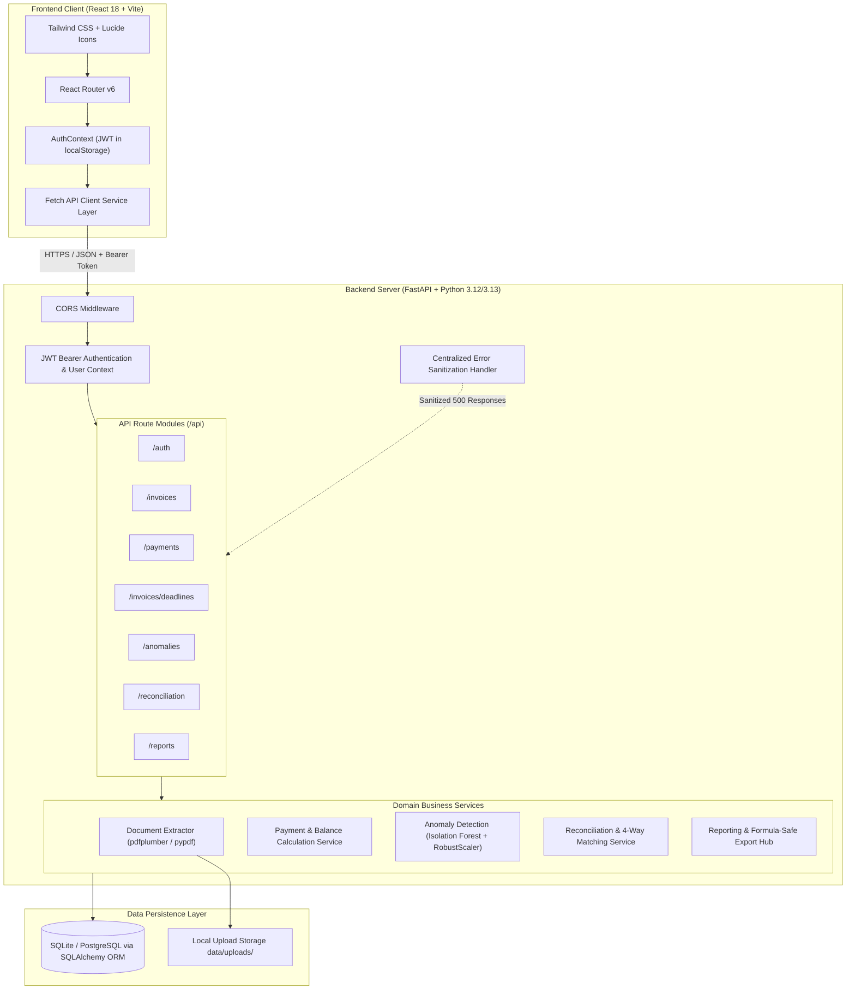

# InvoiceIQ — Financial & Invoice Management System

InvoiceIQ is an intelligent, full-stack financial management and invoice processing web application. It combines automated invoice document parsing, human-in-the-loop review, precision payment and deadline tracking, unsupervised machine learning anomaly screening, 4-way financial reconciliation (Invoices ⟷ General Ledger ⟷ Payments ⟷ Bank Statements), and executive cash-flow reporting with formula-injection-protected exports.

Built from the ground up as an independent, enterprise-grade architecture adhering to clean separation of concerns, strict multi-tenant data isolation, and decimal-safe financial calculations.

---

## 1. Problem Statement & Solution

Small and medium-sized businesses frequently struggle with:
1. **Manual Invoice Data Entry:** Error-prone manual typing of vendor names, dates, taxes, and totals from diverse PDF and image receipts.
2. **Fragmented Payment Tracking:** Lack of visibility into which invoices are overdue, partially settled, or due soon, leading to cash-flow bottlenecks and late fees.
3. **Financial Discrepancies & Fraud Risks:** Difficulty spotting unusual spikes in vendor billing, abnormal tax rates, or duplicate billing attempts without manual line-by-line audits.
4. **Tedious Month-End Reconciliation:** Hours wasted comparing internal invoices against external general ledgers and bank statements to ensure books balance and payments cleared.

**InvoiceIQ solves this** by providing a unified financial hub where uploaded invoices are automatically extracted, tracked through partial or full settlements, statistically audited using machine learning, and reconciled against accounting ledgers and bank statements with one-click payment confirmation.

---

## 2. Genuinely Implemented Features

InvoiceIQ includes fully operational, persistent implementations across all core functional domains:

1. **Authentication & Multi-Tenant Security:**
   - Secure user registration and login with RFC-compliant email validation.
   - Password hashing via `bcrypt` with 12 salt rounds (unique salt per user).
   - Stateless, cryptographically signed JWT Bearer authentication with configurable expiration.
   - Strict tenant isolation: 100% of queries for invoices, payments, anomaly screening, reconciliation batches, and reports enforce `user_id == current_user.id`.
   - Automatic session validation, logout, and token expiration handling in the React client.

2. **Invoice Upload & Automated Extraction:**
   - Authenticated file upload supporting PDF, PNG, JPEG, and WebP documents up to 10MB.
   - Dual-layer file validation: file extension check + binary magic byte signature verification (preventing disguised executables).
   - Real document parsing utilizing `pdfplumber` and `pypdf` with regex-based candidate field extraction:
     - Invoice number detection.
     - Supplier/vendor name detection.
     - Invoice date and due date extraction.
     - Subtotal, tax/GST, and grand total extraction.
     - Currency detection (USD, EUR, GBP, CAD, AUD, INR).
   - Human-in-the-loop verification modal: users review extracted candidate values before committing records to the database. Missing fields are never fabricated.
   - Unique server-side filename generation (`uuid4`) and path traversal protection.
   - Full CRUD: search, filter, paginate, edit, and delete invoices with cascade file deletion.

3. **Payment Tracker & Partial Settlement:**
   - Record full and partial settlements against any saved invoice.
   - Capture payment date, amount, payment method (Bank Transfer, Credit Card, Debit Card, Cash, Cheque, UPI, Other), transaction reference ID, and notes.
   - Overpayment protection: rejects payments exceeding the outstanding balance with an explicit HTTP 400 error.
   - Edit and delete existing payment records with real-time recalculation of invoice balances.
   - Complete payment transactions log table with search and filtering.

4. **Payment Deadline Tracker:**
   - Automatic categorization of invoices based on verified calendar records:
     - **Overdue:** Unpaid or partially paid invoices whose due date has passed.
     - **Due Today:** Due on the current calendar date.
     - **Due in Next 7 Days:** Upcoming near-term obligations.
     - **Due Later / No Due Date:** Future obligations or invoices without an explicit due date.
   - Strict deadline rules:
     - Invoices with no due date are **never** marked overdue.
     - Fully paid invoices are **never** marked overdue, even if past due date.
     - Missing due dates are never invented.
   - Direct 1-click "Pay" button to record payments without leaving the deadline tracker.

5. **Machine Learning Anomaly Detection:**
   - Unsupervised outlier detection powered by `scikit-learn`'s `IsolationForest` (100 isolation trees).
   - Features engineered strictly from genuine database fields (13-feature matrix including log total amount, tax ratio, subtotal ratio, vendor historical spending ratio, account median ratio, payment terms).
   - Features scaled with `RobustScaler` (median & IQR based) to prevent extreme outliers from skewing tree splits.
   - Insufficient data handling: enforces a minimum of 5 saved invoices before fitting trees, preventing arbitrary splits on statistical noise.
   - Factor explainability: provides clear human-readable explanations of why an invoice was flagged (e.g. "Total amount is 4.5x higher than historical median for vendor X").
   - Transparent screening notice: flagged items are designated as **Potentially Unusual** screening signals, never as proof of fraud or accounting errors.
   - User workflow: users can mark flagged items as "Reviewed / Normal" or "Confirmed Issue".

6. **Invoice Verification & Financial Reconciliation Centre:**
   - **Accounting Ledger Reconciliation (CSV/XLSX):**
     - Uploads General Ledger (GL) or Accounts Payable reports with intelligent header auto-mapping.
     - Categorizes records into: Matched, Amount Mismatches, Duplicate Ledger Rows, and Missing Invoices (ghost liabilities).
   - **Bank Statement Reconciliation (CSV/XLSX):**
     - Directionality-aware parser handling debit/credit columns, negative withdrawals, and UTR/reference strings.
     - Reconciles cleared debits against recorded payments and identifies unrecorded vendor settlements.
     - **Critical Safety Enforcement:** Bank statement import NEVER modifies payments or alters invoice balances automatically. Proposed matches require explicit, human-confirmed payment recording (`confirm-payment`).
   - **Combined 4-Way Reconciliation:**
     - Simultaneously cross-verifies: Invoice record ⟷ General Ledger entry ⟷ Recorded Payment ⟷ Cleared Bank debit.
   - **Configurable Penny Tolerance:** Customizable matching tolerance (default ±$0.05) to accommodate banking and FX rounding.
   - **Audit Trail & Formula-Protected Export:** Full audit trail tracking SHA-256 file fingerprints, record review statuses (`CONFIRMED`, `INVESTIGATING`, `DISMISSED`, `PENDING`), and CSV export.

7. **Dashboard & Cash-Flow Reporting:**
   - Live dashboard summary cards: Total Invoiced, Total Paid (with % progress), Outstanding Balance, Overdue Amount, Due in 7 Days, and ML Anomaly count.
   - 6-month continuous cash flow bar chart (Invoiced commitments vs Payments received).
   - Filterable Reports page with quick presets (This Month, Last Month, This Year, All Time) and custom date ranges.
   - Vendor performance breakdown (aggregating total volume, invoiced, paid, balance, and overdue per supplier).

8. **Secure Data Export Hub:**
   - **Invoices Register (CSV):** Complete invoice metadata and payment statuses.
   - **Payment History (CSV):** Transaction logs and reference IDs.
   - **Outstanding Invoices (CSV):** Focused report of unpaid balances and days overdue.
   - **Spreadsheet Formula Injection Protection:** All exported fields starting with dangerous triggers (`=`, `+`, `-`, `@`, `\t`, `\r`) are automatically escaped with a leading single quote (`'`), preventing DDE formula execution in Excel/Sheets.
   - **Executive PDF Report:** Printable financial summary document generated using `reportlab`, displaying account details, generation timestamp, reporting period, executive summary table, and top vendor metrics.

---

## 3. System Architecture



---

## 4. Technology Stack

### Backend
- **Language & Runtime:** Python 3.12 / 3.13
- **Web Framework:** FastAPI (Asynchronous, High-Performance)
- **ASGI Server:** Uvicorn
- **ORM & Database:** SQLAlchemy 2.0 with SQLite (WAL mode, Foreign Keys enforced) / PostgreSQL ready
- **Database Migrations:** Alembic
- **Machine Learning:** Scikit-Learn (`IsolationForest`, `RobustScaler`), NumPy
- **Document Parsing:** `pdfplumber`, `pypdf`, `openpyxl`
- **PDF Generation:** `reportlab`
- **Authentication:** PyJWT, bcrypt

### Frontend
- **Framework:** React 18
- **Build Tool:** Vite 5
- **Styling:** Tailwind CSS (Accessible, Professional Teal Theme)
- **Icons:** Lucide React
- **Routing:** React Router v6

---

## 5. Repository Folder Structure

```
InvoiceIQ_New/
├── backend/
│   ├── alembic/                      # Database migration scripts
│   │   ├── versions/                 # Versioned migration history
│   │   └── env.py                    # Alembic runtime configuration
│   ├── app/
│   │   ├── models/                   # SQLAlchemy ORM models (User, Invoice, Payment, Anomaly, ReconciliationBatch, ReconciliationItem)
│   │   ├── routers/                  # API endpoints (auth, invoices, payments, anomalies, reports, reconciliation)
│   │   ├── schemas/                  # Pydantic validation schemas
│   │   ├── services/                 # Business logic (extractor, payment_service, anomaly_service, report_service, reconciliation_service, reconciliation_parser)
│   │   ├── utils/                    # Security & authentication dependencies
│   │   ├── demo_seed.py              # Isolated demo data seeder
│   │   ├── config.py                 # Pydantic BaseSettings configuration
│   │   ├── database.py               # Engine, sessionmaker, and foreign key listeners
│   │   └── main.py                   # FastAPI application initialization & middleware
│   ├── data/                         # Local database and uploaded attachments storage
│   ├── tests/                        # Comprehensive Pytest test suite (103 automated tests across 15 suites)
│   ├── alembic.ini                   # Alembic settings
│   ├── requirements.txt              # Production Python dependencies
│   ├── run.py                        # Backend entrypoint script
│   ├── .env.example                  # Backend configuration template
│   └── pytest.ini                    # Test runner configuration
├── demo_samples/                     # Curated sample files for live presentations
│   ├── sample_invoice.pdf            # Vector tax invoice document
│   ├── accounting_ledger_sample.csv  # CSV General Ledger with match, mismatch, duplicate, missing rows
│   ├── accounting_ledger_sample.xlsx # Excel General Ledger
│   ├── bank_statement_sample.csv     # CSV Bank Statement with debit, settled, and candidate entries
│   ├── bank_statement_sample.xlsx    # Excel Bank Statement
│   └── README.md                     # Verification guide explaining each sample record
├── docs/                             # Engineering artifacts & presentation materials
│   ├── PROJECT_OVERVIEW.md           # Executive summary, problem statement, and feature matrix
│   ├── TECHNICAL_ARCHITECTURE.md     # In-depth architectural design, schemas, and ML pipeline
│   ├── DEMO_SCRIPT.md                # 5-7 minute live presentation walkthrough
│   ├── INTERVIEW_PREPARATION.md      # Technical Q&A guide (ML vs Recon, Security, Schema)
│   ├── KNOWN_LIMITATIONS.md          # Transparent limits and future engineering roadmap
│   └── PORTFOLIO_PRESENTATION_GUIDE.md # Recruiter demo & portfolio showcase tips
├── frontend/
│   ├── src/
│   │   ├── api/                      # Fetch API client modules (auth, invoices, payments, anomalies, reports, reconciliation)
│   │   ├── components/               # Layout, Sidebar, ProtectedRoute, PublicRoute
│   │   ├── context/                  # AuthContext (JWT management & session state)
│   │   ├── pages/                    # React page views:
│   │   │   ├── Login.jsx             # User authentication with 1-click Demo Fill
│   │   │   ├── Signup.jsx            # User registration
│   │   │   ├── Dashboard.jsx         # Live financial dashboard & cash flow charts
│   │   │   ├── Invoices.jsx          # Invoice upload, review modal, and management
│   │   │   ├── PaymentTracker.jsx    # Payment recording & transaction log
│   │   │   ├── PaymentDeadlines.jsx  # Due date tracking & 1-click settlement
│   │   │   ├── Reconciliation.jsx    # 4-way reconciliation centre (Ledger, Bank, Combined)
│   │   │   ├── AnomalyDetection.jsx  # ML outlier screening interface
│   │   │   └── Reports.jsx           # Financial reports, vendor breakdown & export hub
│   │   ├── App.jsx                   # React Router routing table
│   │   ├── main.jsx                  # React DOM entrypoint
│   │   └── index.css                 # Tailwind CSS styles
│   ├── package.json                  # Frontend dependencies and build scripts
│   ├── vite.config.js                # Vite build configuration
│   ├── tailwind.config.js            # Tailwind theme tokens
│   └── .env.example                  # Frontend configuration template
├── .gitignore                        # Git exclusion rules
├── README.md                         # Project documentation
├── seed_demo.ps1                     # PowerShell wrapper for demo data seeder
└── start_invoiceiq.ps1               # One-command dual-server launcher for Windows
```

---

## 6. Environment Variables Reference

All application secrets and environment variables are externalized into `.env` files (never committed to version control).

### Backend (`backend/.env`)

| Variable Name | Default Value | Description |
|---|---|---|
| `DATABASE_URL` | `sqlite:///./data/invoiceiq.db` | SQLAlchemy connection string (supports SQLite or PostgreSQL). |
| `SECRET_KEY` | *(Set in .env)* | Cryptographic key used to sign HMAC-SHA256 JWT tokens. |
| `ALGORITHM` | `HS256` | JWT signing algorithm. |
| `ACCESS_TOKEN_EXPIRE_MINUTES` | `1440` | JWT token validity window (1440 minutes = 24 hours). |
| `ALLOWED_ORIGINS` | `http://localhost:5173,http://127.0.0.1:5173` | Comma-separated list of allowed CORS origins. |
| `DEBUG` | `True` | Debug mode toggle (automatically disables `/docs` when `False`). |
| `ENVIRONMENT` | `development` | Deployment environment name (`development`, `staging`, `production`). |
| `UPLOAD_DIR` | `./data/uploads` | Path to file attachment storage directory. |
| `MAX_FILE_SIZE_MB` | `10` | Maximum allowable upload file size in megabytes. |

### Frontend (`frontend/.env`)

| Variable Name | Default Value | Description |
|---|---|---|
| `VITE_API_URL` | `http://127.0.0.1:8000/api` | Base HTTP endpoint URL for backend API requests. |

---

## 7. Installation & Setup (First-Time Setup)

### Prerequisites
- **Windows 10 / 11** (or Linux / macOS)
- **Python 3.12 or 3.13** (`python --version`)
- **Node.js v18+ or v20+** (`node --version`)
- **npm v9+ or v10+** (`npm --version`)
- **PowerShell 5.1+ or 7+**

### Step 1: Set Up Backend Virtual Environment
```powershell
cd C:\Users\aditi\Downloads\InvoiceIQ_New\backend
python -m venv .venv
.\.venv\Scripts\Activate.ps1
python -m pip install --upgrade pip
pip install -r requirements.txt
```

### Step 2: Configure Backend Environment Variables
```powershell
Copy-Item .env.example .env
```

### Step 3: Run Database Migrations
Initialize the SQLite database with all tables:
```powershell
alembic upgrade head
```

### Step 4: Set Up Frontend Dependencies
```powershell
cd C:\Users\aditi\Downloads\InvoiceIQ_New\frontend
Copy-Item .env.example .env
npm.cmd install
```

---

## 8. Starting & Stopping the Application

### One-Command Launcher (Recommended for Windows)
From the project root:
```powershell
powershell -ExecutionPolicy Bypass -File .\start_invoiceiq.ps1
```

This automated script will:
1. Validate Python and Node dependencies.
2. Ensure `.env` files exist.
3. Check and safely apply any pending Alembic migrations.
4. Launch the **FastAPI Backend** on `http://127.0.0.1:8000` in its own terminal window.
5. Launch the **Vite React Frontend** on `http://127.0.0.1:5173` in a second terminal window.

### Manual Multi-Terminal Startup

**Terminal 1 (Backend):**
```powershell
cd C:\Users\aditi\Downloads\InvoiceIQ_New\backend
.\.venv\Scripts\Activate.ps1
python run.py
```

**Terminal 2 (Frontend):**
```powershell
cd C:\Users\aditi\Downloads\InvoiceIQ_New\frontend
npm.cmd run dev
```

### Stopping the Servers
Close both terminal windows, or press `Ctrl + C` in each window.

---

## 9. Application URLs & Documentation

| Service | URL | Description |
|---|---|---|
| **Web Application** | `http://127.0.0.1:5173` | React Frontend UI |
| **API Base URL** | `http://127.0.0.1:8000` | FastAPI Backend |
| **Interactive Swagger Docs** | `http://127.0.0.1:8000/docs` | OpenAPI documentation & interactive testing |
| **ReDoc Documentation** | `http://127.0.0.1:8000/redoc` | Clean, structural API documentation |
| **Health Check Endpoint** | `http://127.0.0.1:8000/api/health` | Service status & timestamp |

*(Note: In production with `DEBUG=False`, `/docs` and `/redoc` are automatically disabled for security.)*

---

## 10. Running Automated Tests

InvoiceIQ includes **116 automated unit and integration tests across 16 test suites** covering authentication, extraction, invoice lifecycle, payment arithmetic, deadline tracking, machine learning anomaly detection, reports, CSV/PDF exports, 4-way financial reconciliation, column auto-mapping intelligence, and security audits.

To run the backend test suite:
```powershell
cd C:\Users\aditi\Downloads\InvoiceIQ_New\backend
.\.venv\Scripts\python.exe -m pytest tests -v
```

To run a production frontend build check:
```powershell
cd C:\Users\aditi\Downloads\InvoiceIQ_New\frontend
npm.cmd run build
```

---

## 11. Showcase Demo Mode

InvoiceIQ provides an isolated, repeatable demo dataset designed for recruiter demonstrations and portfolio walkthroughs:

### Quick Start Demo Mode
```powershell
# 1. Populate/Reset the isolated demo showcase account
powershell -ExecutionPolicy Bypass -File .\seed_demo.ps1

# 2. Start both frontend and backend
powershell -ExecutionPolicy Bypass -File .\start_invoiceiq.ps1
```

- **Demo Login:** `demo@invoiceiq.local`
- **Password:** `DemoUser123!`
- *(Or click the **"Fill Demo Credentials"** button on the login screen)*

### Curated Demo Data Features
The demo dataset populates **10 realistic sample invoices** spanning all key financial states without touching any user data:
- **Unpaid Invoice:** `INV-DEMO-001` ($450.00, due in 12 days).
- **Partially Paid Invoice:** `INV-DEMO-002` ($250 paid of $620 total, balance due $370).
- **Fully Settled Invoice:** `INV-DEMO-003` ($850 settled across two payment tranches).
- **Overdue Invoice:** `INV-DEMO-004` (due 14 days ago, unpaid).
- **No Due Date Invoice:** `INV-DEMO-005` (gracefully handled without erroneous overdue flags).
- **ML Statistical Outlier:** `INV-DEMO-008` ($12,850 GPU cluster vs $455 vendor median, flagged as `POTENTIALLY_UNUSUAL` with human-readable rationale).

### Clean Teardown
```powershell
powershell -ExecutionPolicy Bypass -File .\seed_demo.ps1 -Clean
```

---

## 12. Troubleshooting Guide

| Issue | Root Cause | Solution |
|---|---|---|
| `Port 8000 already in use` | A lingering Python or Uvicorn process is holding port 8000. | Run `Get-Process python -ErrorAction SilentlyContinue \| Stop-Process -Force` in PowerShell, then restart. |
| `Port 5173 already in use` | A previous Vite dev server is still running. | Run `Get-Process node -ErrorAction SilentlyContinue \| Stop-Process -Force` in PowerShell. |
| `Activate.ps1 cannot be loaded because running scripts is disabled` | PowerShell execution policy restriction on Windows. | Run `Set-ExecutionPolicy -Scope CurrentUser -ExecutionPolicy RemoteSigned`, or launch scripts with `-ExecutionPolicy Bypass`. |
| `database disk image is malformed` / lock error | SQLite file locked by an interrupted write. | Run `backend/.venv/Scripts/python.exe -c "import sqlite3; c=sqlite3.connect('backend/data/invoiceiq.db'); print(c.execute('PRAGMA integrity_check').fetchall())"`. The engine is configured with WAL mode and `timeout=30.0` to minimize locks. |
| `alembic: command not found` | Python virtual environment is not activated. | Run `.\.venv\Scripts\Activate.ps1` before running `alembic upgrade head`, or use `.\.venv\Scripts\python.exe -m alembic upgrade head`. |
