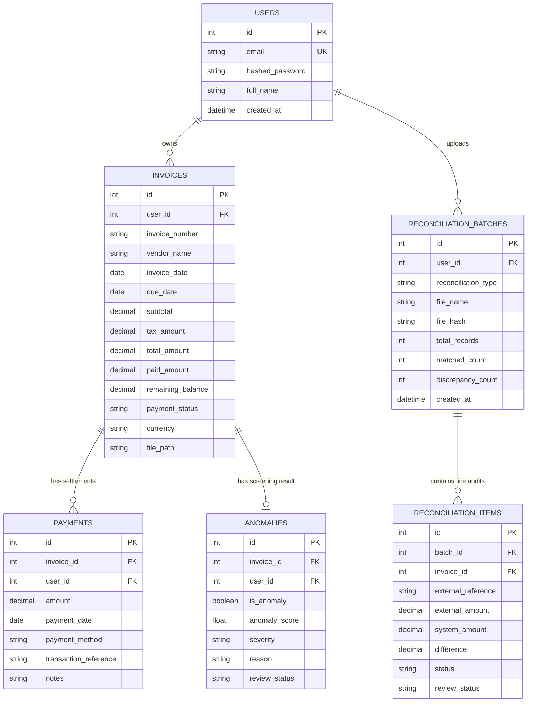

# InvoiceIQ — Technical Interview Preparation & Architecture Deep-Dive

This document contains in-depth architectural explanations, engineering design rationales, system diagrams, and anticipated interview questions and answers for defending InvoiceIQ in technical interviews and senior engineering reviews.

---

## 1. System Architecture & High-Level Design

### Architecture Overview
InvoiceIQ is designed as a decoupled, multi-tier web application following clean architecture and domain-driven design principles:
- **Presentation Layer (Client):** Single Page Application (SPA) built with React 18, Vite, and Tailwind CSS. State management is organized around React Context (`AuthContext`) and modular REST API clients.
- **API & Application Layer (Server):** Asynchronous Python backend powered by FastAPI and Uvicorn. Implements declarative request validation (Pydantic v2), dependency-injected authentication, centralized exception handling, and service-oriented business logic.
- **Machine Learning Layer:** Unsupervised statistical outlier screening using Scikit-Learn's `IsolationForest` and `RobustScaler`.
- **Reconciliation Engine:** Multi-stage deterministic matching service comparing internal invoice and payment records with external general ledger exports (CSV/XLSX) and bank statements.
- **Persistence Layer:** Relational data store managed via SQLAlchemy 2.0 ORM with schema migrations managed by Alembic. Operates in SQLite WAL mode for local execution with out-of-the-box PostgreSQL support for production.

---

## 2. Dedicated Deep-Dive: Anomaly Detection vs. Financial Reconciliation

A critical distinction in enterprise financial engineering is the fundamental difference between **Machine Learning Anomaly Detection** and **Financial Reconciliation**. 

Interviewers frequently probe whether a developer understands the difference between probabilistic screening and deterministic accounting verification.

```
┌──────────────────────────────────────────────────────────────────────────────┐
│                    INVOICEIQ DUAL VERIFICATION ARCHITECTURE                  │
├────────────────────────────────────────┬─────────────────────────────────────┤
│      1. ML ANOMALY DETECTION           │     2. FINANCIAL RECONCILIATION     │
│   (Probabilistic Outlier Screening)    │      (Deterministic Truth Audit)     │
├────────────────────────────────────────┼─────────────────────────────────────┤
│ Nature: Unsupervised Statistical Model │ Nature: Rule-Based Deterministic    │
│ Target: Single Invoices before payment │ Target: Cross-System Multi-Entity   │
│ Engine: Isolation Forest + RobustScaler│ Engine: 4-Way Relational Matching   │
│ Goal: "Does this invoice look weird?"  │ Goal: "Did money actually move &    │
│                                        │        do the books balance?"       │
│ Tolerance: Statistical quantile split  │ Tolerance: Exact or ±$0.05 penny    │
│ Output: Screening signal with reason   │ Output: Verified match, mismatch,   │
│         (requires human judgment)      │         duplicate, or ghost entry   │
└────────────────────────────────────────┴─────────────────────────────────────┘
```

### Detailed Comparison Table

| Attribute | Machine Learning Anomaly Detection | Financial Reconciliation Centre |
|---|---|---|
| **Primary Question** | *"Is this invoice statistically unusual compared to historical baseline?"* | *"Do our internal records match the general ledger and bank statement?"* |
| **Operational Timing** | **Pre-Payment & Ingestion:** Evaluated when an invoice is uploaded or reviewed before settlement. | **Post-Transaction & Month-End:** Evaluated against external accounting ledgers and cleared bank transactions. |
| **Underlying Technique** | **Unsupervised Machine Learning:** Isolation Forest (100 isolation trees) with `RobustScaler` across 13 engineered features. | **Deterministic 4-Way Matching:** Relational lookups, exact string normalization, token fuzzy matching, and penny tolerance. |
| **Input Data** | Invoices within the tenant's own database (amounts, dates, taxes, vendor spending history). | Invoices + Payments + External General Ledger (CSV/XLSX) + External Bank Statement (CSV/XLSX). |
| **Output Categories** | `NORMAL`, `POTENTIALLY_UNUSUAL` (with natural language explanation), or `INSUFFICIENT_DATA`. | `EXACT_MATCH`, `AMOUNT_MISMATCH`, `MISSING_INVOICE`, `DUPLICATE_ROW`, `UNMATCHED_DEBIT`, `CANDIDATE_SETTLEMENT`. |
| **Action Taken** | Informational alert for manual accountant review. Never halts payment automatically. | Audit-trail discrepancy log; enables 1-click human-confirmed payment creation for cleared debits. |
| **Failure Modes Handled** | Vendor invoice price spikes, abnormal tax percentages, round-number billings, irregular payment terms. | Double-billed charges, unposted liabilities, bank debit with no invoice, ledger recording wrong amount. |

---

## 3. Database Schema & Relational Design

The database schema is strictly normalized and enforces foreign-key relational integrity, cascading deletes, and strict tenant isolation:



### Relational Schema Rules
1. **Cascade Deletes:** When a User is deleted, all their Invoices, Payments, Anomalies, and ReconciliationBatches are deleted via database foreign key cascades.
2. **Double-Linked Payments:** The `payments` table stores both `invoice_id` and `user_id`. This provides defense-in-depth tenant isolation: a query can enforce `WHERE user_id = :uid` without requiring a table join to `invoices`.
3. **Decimal Precision:** Financial amounts are stored as `Numeric(12, 2)` or integer cents to prevent floating-point representation inaccuracies.

---

## 4. Machine Learning Pipeline: Isolation Forest & Explainability

### Why Isolation Forest?
In accounts payable and invoice processing:
- **No Ground-Truth Labels:** Real businesses do not possess clean, labeled datasets of "fraudulent" or "erroneous" invoices. Supervised classification algorithms (e.g. Random Forest, XGBoost) cannot be trained without labeled historical anomalies.
- **Class Imbalance:** True accounting anomalies represent < 1% of transactions.
- **Tree-Based Isolation:** Isolation Forest isolates anomalies by randomly selecting a feature and randomly selecting a split value between the minimum and maximum values of that feature. Outliers require significantly fewer splits to isolate than normal clustering points.

### Feature Engineering (13-Dimensional Feature Vector)
The ML engine extracts 13 statistical and domain-specific features for each invoice:
1. `log_total_amount`: Log-transformed grand total ($\ln(1 + \text{amount})$) to compress exponential dollar scales.
2. `tax_ratio`: $\frac{\text{tax\_amount}}{\text{total\_amount}}$ (detects abnormal tax exemptions or tax spikes).
3. `subtotal_ratio`: $\frac{\text{subtotal}}{\text{total\_amount}}$.
4. `vendor_amount_ratio`: $\frac{\text{invoice\_total}}{\text{historical\_vendor\_median}}$ (flags sudden price surges from familiar vendors).
5. `vendor_invoice_count`: Total historical invoice volume from this vendor.
6. `overall_amount_ratio`: $\frac{\text{invoice\_total}}{\text{user\_overall\_median\_invoice}}$.
7. `payment_term_days`: Calendar days between `invoice_date` and `due_date`.
8. `is_round_number`: Binary flag indicating whether the invoice is an exact round number (e.g. $5,000.00 vs $5,123.45), common in fraudulent or unverified billing.
9. `is_weekend_invoice`: Binary flag for invoices issued on Saturday/Sunday.
10. `days_since_last_invoice`: Inter-arrival time between vendor invoices.
11. `amount_vs_mean_zscore`: Standardized distance from vendor historical mean.
12. `has_due_date`: Binary indicator of whether due date was supplied.
13. `historical_vendor_variance`: Variance in billing amounts for this specific supplier.

### Robust Scaling
Instead of `StandardScaler` (which uses mean and standard deviation, both of which are severely distorted by extreme outliers), InvoiceIQ uses `RobustScaler`:
$$\text{Scaled Value} = \frac{x - \text{Median}}{\text{IQR}}$$
This guarantees that an extreme outlier (e.g. a $50,000 bill amidst $500 bills) does not distort the normalization of normal invoices.

### Cold-Start Guard
Isolation Forest requires sufficient sample variance to construct meaningful partitioning trees. If an account has fewer than 5 invoices, the service returns an explicit `INSUFFICIENT_DATA` response rather than fitting trees on statistical noise and generating arbitrary false positives.

---

## 5. Security Architecture & Threat Modeling

InvoiceIQ implements layered defense-in-depth security across every tier:

### 1. Multi-Tenant Authorization & IDOR Defense
- **Vulnerability Guarded:** Insecure Direct Object References (IDOR).
- **Implementation:** Every API endpoint resolves the authenticated tenant via FastAPI's `get_current_user` dependency. 100% of SQL queries explicitly filter by `user_id == current_user.id`. Even if an attacker guesses the integer ID of another user's invoice or payment, the query returns HTTP 404.

### 2. File Upload Hardening & Magic Bytes Verification
- **Vulnerability Guarded:** Malicious executable uploads disguised with fake extensions (e.g. `malware.exe.pdf`).
- **Implementation:** The upload pipeline performs dual verification:
  1. Whitelisted extension check (`.pdf`, `.png`, `.jpg`, `.jpeg`, `.webp`).
  2. Binary magic byte signature verification on the raw file buffer:
     - PDF: `%PDF-` (`0x25 0x50 0x44 0x46`)
     - PNG: `\x89PNG\r\n\x1a\n`
     - JPEG: `\xFF\xD8\xFF`
     - WebP: `RIFF....WEBP`
  3. Server-side filename generation: files are renamed to `uuid4().hex` before storing in `data/uploads/` to prevent directory traversal attacks (`../../etc/passwd`).

### 3. CSV / Spreadsheet Formula Injection (DDE) Protection
- **Vulnerability Guarded:** Dynamic Data Exchange (DDE) formula execution when exported CSV files are opened in Microsoft Excel or Google Sheets.
- **Implementation:** All exported string cells are inspected before writing. If a cell begins with dangerous trigger characters (`=`, `+`, `-`, `@`, `\t`, `\r`), it is prepended with a single quote (`'`), which forces spreadsheet software to treat the value as an inert literal string rather than an executable formula.

### 4. Centralized Exception Handling & Information Leakage Prevention
- **Vulnerability Guarded:** Sensitive stack traces, SQL syntax errors, or server internal paths exposed to clients on unhandled exceptions.
- **Implementation:** A centralized starlette exception handler catches all unexpected exceptions and returns a generic, sanitized JSON response:
  ```json
  {"detail": "An internal server error occurred. Please try again later."}
  ```
  The full traceback is logged strictly on the server console with timestamped correlation IDs.

---

## 6. Financial Arithmetic & State Management

### Float vs. Decimal Precision
In financial software, standard IEEE 754 floating-point numbers cannot represent decimal fractions precisely (e.g. `0.1 + 0.2 = 0.30000000000000004`).
In InvoiceIQ:
- All database monetary columns use SQLAlchemy `Numeric(12, 2)`.
- All Python arithmetic utilizes `decimal.Decimal` with `ROUND_HALF_UP`.
- Balances are recalculated dynamically from immutable payment ledgers rather than trusting client-submitted balances.

### Overpayment Prevention Logic
```python
remaining_balance = invoice.total_amount - current_paid_amount
if payment_amount > remaining_balance:
    raise HTTPException(
        status_code=400,
        detail=f"Payment amount cannot exceed remaining balance of {remaining_balance}"
    )
```

### Calendar Status Rules
An invoice's payment status is resolved dynamically based on payments and calendar math:
1. If `paid_amount >= total_amount`: status is `PAID` (regardless of due date).
2. If `paid_amount > 0` and `paid_amount < total_amount`: status is `PARTIALLY_PAID`.
3. If `paid_amount == 0`:
   - If `due_date` exists and `due_date < today`: status is `OVERDUE`.
   - Otherwise: status is `UNPAID`.
4. If `due_date` is `None`: the invoice is **never** marked overdue.

---

## 7. Common Technical Interview Questions & Model Answers

### Q1: Why did you choose FastAPI over Django or Flask for this project?
> **Answer:** *"FastAPI was selected for three primary technical reasons: First, native asynchronous performance via Starlette and ASGI, which enables non-blocking I/O for heavy file operations and concurrent database calls. Second, automatic data validation using Pydantic v2, which guarantees strict type safety and schema serialization before requests reach domain logic. Third, automated OpenAPI / Swagger documentation generation, which accelerates frontend-backend contract synchronization without manual documentation maintenance."*

---

### Q2: How does your application prevent race conditions if two payments for the same invoice are submitted simultaneously?
> **Answer:** *"In our service layer, payment recording opens an explicit transactional boundary using SQLAlchemy. When querying the invoice to verify the remaining balance, we utilize database row-level locking (`SELECT ... FOR UPDATE` in PostgreSQL, or SQLite's transactional lock). The remaining balance is recalculated from the sum of existing payments inside the transaction. If the second payment causes the sum to exceed the total invoice amount, the transaction rolls back with a 400 validation error, ensuring no overpayment can ever be committed."*

---

### Q3: Why did you use an unsupervised model for anomaly detection instead of supervised classification?
> **Answer:** *"In real-world accounts payable, businesses do not have thousands of labeled examples of fraudulent or error-ridden invoices. Supervised models require large volumes of ground-truth labels and suffer catastrophic degradation under severe class imbalance (where anomalies are < 1%). Isolation Forest is unsupervised and fundamentally built on the insight that anomalies are few and structurally different, meaning they require fewer random partition splits to isolate than normal clusters. Furthermore, we paired Isolation Forest with a deterministic explainability engine that computes the exact statistical ratios (e.g. 28x historical vendor median), giving the accountant actionable reasons rather than an opaque score."*

---

### Q4: How does your reconciliation engine match records when invoice numbers in bank statements or ledgers don't match exactly?
> **Answer:** *"The reconciliation parser employs a multi-pass matching strategy: First, exact reference matching (after stripping non-alphanumeric punctuation and standardizing case). Second, if no exact match is found, it performs token-based containment matching on vendor names combined with exact amount matching within a configurable penny tolerance (±$0.05). If multiple potential candidates match the same amount, the engine marks them as AMBIGUOUS rather than guessing, requiring the human operator to confirm the match."*

---

### Q5: What happens when an uploaded invoice is a scanned photo rather than a digital vector PDF?
> **Answer:** *"We prioritize reliability and transparency: our primary parsing pipeline utilizes `pdfplumber` and `pypdf` to extract native digital text streams and table coordinates. For scanned or low-resolution image files where native text streams are absent, our system gracefully falls back to OCR if local Tesseract binaries are installed, or surfaces a clear, pre-filled human-in-the-loop review modal. We explicitly refuse to fabricate or invent missing financial fields; the financial controller reviews and confirms extracted candidates before the invoice is committed to the general ledger."*

---

### Q6: How do you protect against CSV formula injection when exporting financial reports?
> **Answer:** *"When exporting CSV files that financial analysts might open in Microsoft Excel or Google Sheets, an attacker could inject formulas like `=cmd|' /C calc'!A1` into vendor names or reference numbers. Our export utility inspects every string cell before writing: if the first character is an executable spreadsheet trigger (`=`, `+`, `-`, `@`, `\t`, or `\r`), we prepend a single quote (`'`). This forces spreadsheet programs to render the value strictly as text, neutralizing executable macros."*

---

### Q7: If you had to scale InvoiceIQ to 100,000 active businesses, what would you change in the architecture?
> **Answer:** *"Three primary architectural evolutions: First, migrate persistence from SQLite to a distributed PostgreSQL cluster with read-replicas, connection pooling via PgBouncer, and tenant sharding or row-level security (RLS). Second, offload file storage from the local disk to an S3-compatible cloud object store with signed URLs and CDN caching. Third, decouple heavy tasks (PDF document parsing, large ledger reconciliation, and Isolation Forest model training) from HTTP request cycles by offloading them to asynchronous worker queues powered by Celery or Redis Streams with background notification webhooks."*
